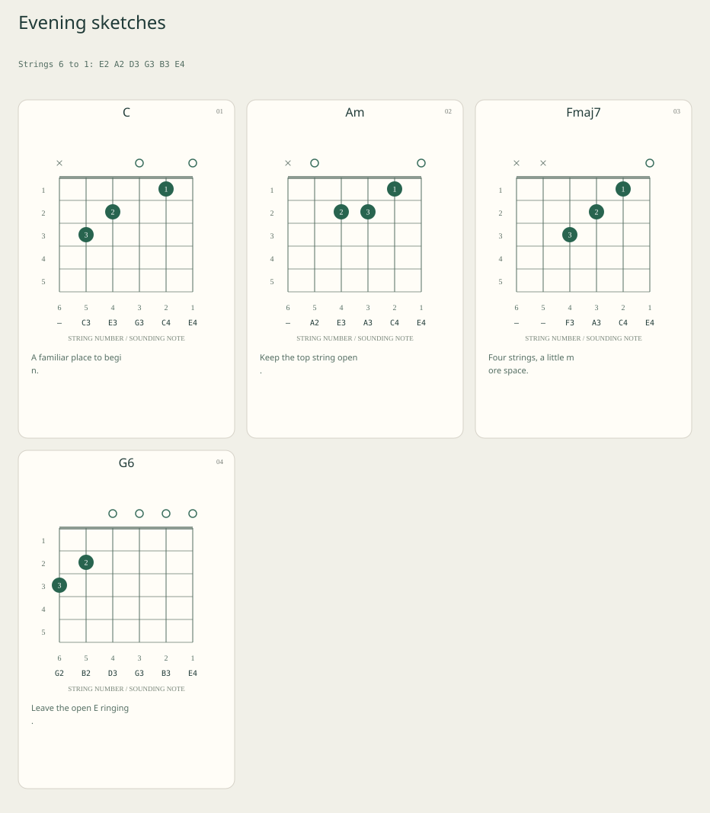

# Voicingpad

[Open Voicingpad](https://voicingpad.vercel.app)

A small, browser-local notebook for the guitar shape you actually play. Capture six string positions, add finger labels and reminders, arrange your cards, and export a clean SVG board.



This image is an **actual generated export**, not an editor screenshot. A native application screenshot and browser visual checks have not been captured.

## What it does

- Keeps exact muted, open and fretted positions on six strings.
- Records your own voicing name, optional finger numbers and a short reminder.
- Moves, clones, adds and deletes cards without replacing your shape with a library fingering.
- Uses one custom six-string tuning for the board and calculates a string-by-string sounding-pitch receipt.
- Mirrors diagrams for left-handed viewing while keeping physical string identities intact.
- Shows starting fret numbers automatically, including high-position shapes.
- Separates unapplied drafts from the applied board used by downloads.
- Saves editable JSON projects and exports individual cards or the complete board as SVG.
- Provides 25 undo states, plus redo, for applied edits and loaded projects.

There is no account, upload endpoint, cloud storage, analytics or paid dependency.

## Try the example

The repository contains an [editable project](examples/project.json), [complete SVG board](examples/board.svg), [selected card SVG](examples/card.svg) and [pitch receipt](examples/pitches.json). Regenerate these actual outputs with:

```sh
npm run example
```

The demo uses four common shapes in standard tuning. These are editable labels and positions, rather than a song arrangement or a claim that an automatic chord-name detector has identified them.

For the C shape:

```text
Strings:  6   5   4   3   2   1
Frets:    x   3   2   0   1   0
Fingers:  -   3   2   -   1   -
Notes:    —  C3  E3  G3  C4  E4
```

## Run locally

Use Node.js 22 or 24 and npm.

```sh
npm ci --ignore-scripts --no-audit --no-fund
npm test
npm run build
npm run dev
```

Open `http://127.0.0.1:4195`. The local preview binds to localhost and serves only allowlisted assets from `dist/`. Stop it with Ctrl+C.

The production app and build have no third-party runtime dependencies. jsdom is used only for development tests.

## Capture a shape

1. Select a card, or add a blank voicing.
2. Enter six space-separated fret values in **physical string 6 → 1 order**. Use `x` for muted, `0` for open and `1`–`24` for a fret. Example: `x 10 12 12 11 10`. Compact entries such as `x32010` are deliberately rejected.
3. Enter six optional finger labels. Use `-` for no label and `1`–`4` only on fretted strings. Example: `- 1 3 4 2 1`.
4. Add your own name and reminder, then select **Apply shape**.
5. Clone a shape to try a variation, move cards earlier or later, and save the project when you want to keep it.

Repeated finger labels can annotate a barre. No connecting barre line is drawn. Finger labels do not assert that a fingering is practical.

Frets are absolute positions on the instrument, not relative to the displayed window. A fretted shape must fit five consecutive frets; muted and open strings do not determine the window. Wider shapes fail validation instead of losing dots outside the diagram.

## Tuning and orientation

Board settings accept six scientific pitch names, including octaves, such as:

```text
Standard: E2 A2 D3 G3 B3 E4
Drop D:   D2 A2 D3 G3 B3 E4
```

A single `#`, `b`, `♯` or `♭` accidental is accepted. Open-string pitches must fall from MIDI 24 through 84 (C1–C6). Applying tuning changes the sounding-pitch receipt while keeping the fret positions fixed.

The calculation is `open-string MIDI pitch + fret`; muted strings have no sounding pitch. Pitch names use the MIDI convention C4 = 60 and twelve equal semitones per octave. The [UNSW note/MIDI reference](https://newt.phys.unsw.edu.au/jw/notes.html) explains the convention.

Spelling uses a simple sharp or flat pitch-class table. It does not analyze keys or produce theoretical enharmonic spelling. This is a pitch representation, not a tuner or an audio measurement.

Left-handed view mirrors the string columns. Input and saved projects continue to use string 6 → 1 order, and the diagram prints physical string numbers below the grid.

## Drafts, history and files

Shape and settings fields have separate drafts. Applying one preserves an unapplied draft in the other. Apply or discard drafts before changing selection, order or undo history.

Downloads and Copy selected fret entry use **applied values only**. Invalid entries preserve the current board and download files while leaving the attempted draft available to correct.

Opening a project or loading the demo replaces the board and drafts. The previous applied board remains undoable in this tab. A malformed, oversized, unsupported or invalid-UTF-8 file is not applied. A slow read cannot overwrite a newer draft/edit or a newer selected file.

There is no autosave or automatic recovery after closing the tab. Save the JSON project first.

## Exports

| File | Contains |
| --- | --- |
| Project JSON | Applied title, tuning MIDI values, spelling, orientation, ordered cards, names, reminders, frets, fingers and local card IDs |
| Complete board SVG | Every applied card in order, tuning, orientation, finger labels, fret numbers, note names and reminders |
| Selected card SVG | The applied selected shape and its annotations |
| Pitch receipt JSON | Applied board settings and each card's six string records, including open MIDI pitch, fret, finger, sounding MIDI pitch and spelled note |

Projects use `voicingpad-project-v1`; receipts use `voicingpad-receipt-v1`. A receipt is not a resumable project. Unsupported fields and schema versions are rejected. Selection, drafts and undo/redo history are not saved.

SVG exports contain vector geometry and escaped text without scripts, external images or linked fonts. They use basic font families available to the receiving viewer. Names and reminders wrap by code point; complex grapheme shaping and exact font metrics are not controlled. Test an export in your target document or design app.

## Limits

| Boundary | Limit |
| --- | --- |
| Voicing cards | 1–24 |
| Strings per card | Exactly 6 |
| Fret values | Muted, open, or 1–24 |
| Positive-fret span | At most 4 fret steps, fitting a five-fret window |
| Finger labels | None, or 1–4 on fretted strings |
| Board title | 80 UTF-16 code units |
| Card name / reminder | 40 / 120 UTF-16 code units |
| Project text | 30,000 UTF-16 code units |
| UTF-8 project file | 120,000 bytes |
| Applied undo states | 25 |

Text must be single-line, well-formed Unicode without C0 controls, DEL or Unicode line separators.

No automatic chord naming, chord-library lookup, audio playback, rhythm sequencing, transposition, capo model, voice-leading analysis, physical playability checks, lyrics, notation, PNG/PDF generation, synchronization or installed/offline cache is included. Six strings and one tuning per board are fixed boundaries.

## Verification

`npm test` exercises known MIDI/pitch cases, all allowed open-string pitches in both spellings, high-fret geometry, left/right mirroring, explicit expected SVG dot positions, escaped labels, 24-card complete exports, strict project validation and immutable edits.

Actual application handlers are tested in **simulated DOM**: separate draft preservation, rejected shapes, selection and history boundaries, copy/download payloads, current Blob URL attributes and revocation, malformed UTF-8, undoable file recovery and overlapping file reads.

CI runs tests and build on Windows/Linux with Node 22/24. The Checks workflow also supports manual runs from GitHub Actions. Simulated DOM and SVG parsing do not verify native browser image rendering, responsive appearance, assistive-technology behavior, clipboard permissions, native file destinations, physical printing or compatibility with a specific design app. Native browser checks and an editor screenshot remain pending.

## Deploy on Vercel

Import this repository on your existing account:

- Framework: **Other**
- Root directory: repository root
- Node.js: **24.x**
- Build command: `npm run build`
- Output directory: `dist`
- Install command: leave empty / override with no command

The build uses Node built-ins. No environment variables, functions, APIs, databases, purchased domains or paid infrastructure are needed. `vercel.json` supplies the static build settings and security headers.

## Privacy and license

The board stays in tab memory until you choose a copy or download operation. No browser storage, cookies, analytics, third-party fonts or application data requests are used. The host still serves static assets and may retain ordinary request metadata.

MIT licensed; see [LICENSE](LICENSE).
